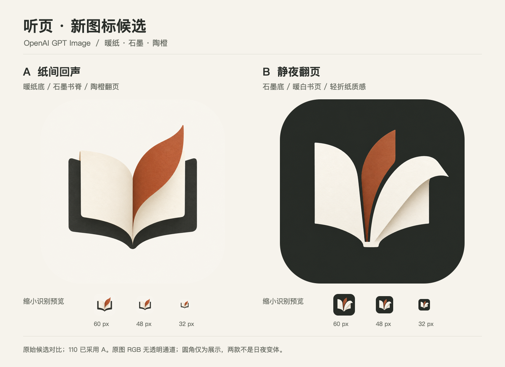

# 听页 · 纸间回声 / GPT Image 应用图标

根据 v19「余白」已实现的界面重新设计图标。用户要求「应用并推送 TestFlight」后，按前述推荐采用 **A「纸间回声」**，已应用到 **1.21.0（110）** 并完成 iOS/iPadOS + Mac Catalyst 上传。两端均收到 Apple 成功回执；最后状态为处理中，**尚未确认可安装**。未提交正式审核、未修改测试组。

## 预览与原图



- **A「纸间回声」**：[1024px 原图](a-paper-echo-original.png)。暖纸底、石墨书脊与陶橙翻页，偏温暖、文学、阅读感，与日间界面更贴近。
- **B「静夜翻页」**：[1024px 原图](b-night-pages-original.png)。石墨底、暖白展开书页和陶橙内页，轮廓更抽象，主屏幕对比更明显。

两款是不同的图标方向，**不是同一图形的日间／深色变体**。A 已采用，B 仅保留为未使用候选；上图为最初候选对比。

## 构建 110 正式资源


- `final/AppIcon.png`：与 A 的 GPT 原图逐字节一致，SHA-256 `33db09b79e9cc7fef3f9ca79917ed8b2ececc8a9a34f03761df220049618ec04`。
- `final/AppIcon-dark.png`：同一 A 位图做边缘连通背景选择、少量蒙版平滑与去白边、背景换深色及书脊提亮；保留书页与陶橙材质，没有另画几何。
- `final/AppIcon-tinted.png`：同一深色适配结果的中性灰阶，逐像素验证 R=G=B，供系统着色。
- 三张正式资源均为 **1024×1024、8-bit RGB、无 alpha**，已与 Assets 中的文件逐字节核对。没有把预览圆角写入原图。
- `prepare-variants.swift` 是颜色与位图蒙版适配，不是图标绘制器；本次应用阶段没有额外调用图片生成模型。

## 实际生成来源

- 模型：**OpenAI `gpt-image-2.5-sunburst`**。
- 调用接口：Figma MCP `generate_image`；实际调用两次，使用 Figma AI 额度。不是通过脚本绘制图标，也不是冒充 ChatGPT 网页操作。
- 设计依据：`../v19-margin/runtime/light-overview.jpg`、`dark-overview.jpg` 和设计令牌。助手读取实际 SwiftUI 界面后，将构图、软件用途和暖纸／石墨／陶橙配色写入提示词；接口不支持直接传参考图片，未声称模型实际接收了截图。
- 两张 `*-original.png` 是下载的模型原始输出，**未重绘、描摹、换色或裁切**。
- 已验证：均为 **1024×1024、8-bit RGB PNG、无 alpha 通道**。原图 SHA-256 与生成记录见 [generation.json](generation.json)；完整提示词见 `prompt-a-paper-echo.txt` / `prompt-b-night-pages.txt`。
- `make-preview.swift` 只排列原图、缩放、加预览圆角与标题，不生成或修改图标主体。圆角仅用于展示，不写入原图。

## Figma

[正式三变体](https://www.figma.com/design/xJdLrqBJ9bUkstoEIG1CKY?node-id=21-63) / [原候选对比](https://www.figma.com/design/xJdLrqBJ9bUkstoEIG1CKY?node-id=15-64)

- 页面 `15:63`；正式容器 `21:63`，日间 / 深色 / 着色 `21:64` / `21:65` / `21:66`。
- 原候选容器 `15:64`；A `15:65`，B `15:66`。
- 图片作为独立位图资产放置，**不是可编辑矢量图标**。原有 30 张 UI 画板和 109「折页声窗」图标母版保留。

## 保存现有版本

最初生成候选时没有更改正式资源，那个阶段的记录保留于 `generation.json` 与 `build/icon-margin-gpt/published-109-icons.sha256`；不要将其中的候选状态误当作当前发布状态。应用 110 前保存了旧资源及工程配置，见 `build/before-icon-110/`。

110 冻结了 137 个构建 / 测试输入，与 109 相比仅改变 3 张图标和工程 / 重建脚本的构建号；既有未提交工作、业务代码、用户数据与偏好未改动。

## 110 验证与上传

- iPhone SE 3 / iOS 27.0：**86 核心 + 18 UI = 104 项 Debug 回归通过，0 失败、0 跳过**。结果 `build/Release110Tests.xcresult`。
- iOS arm64 和 Mac Catalyst arm64 + x86_64 Release 归档通过；版本、签名、iCloud / Keychain 权限、dSYM、隐私清单与 DEBUG 隔离检查通过。
- 包内三变体均不透明，并核对编译资产摘要全部不同于 109，确认不是旧图标缓存；Mac 默认图标与 iOS 摘要一致。
- `build/upload-110.log` / `build/upload-110-mac.log` 均为 **`Upload succeeded` / `EXPORT SUCCEEDED`，退出码 0**。最后回执为 `Uploaded package is processing`，不证明 TestFlight 已可安装。
- 证据：[testflight-110.json](final/testflight-110.json)、`build/release-110-{ios,mac}-checks.json`、`build/release-110-source-manifest.json`。没有正式审核、测试组变更或 Git 提交。
- 模拟器、归档与图标检查不能代替实际安装、真机服务及完整 Catalyst 交互验证。

重新生成对比预览（不调用模型、不消耗额度）：

```sh
swift Design/icon-margin-gpt/make-preview.swift
```
