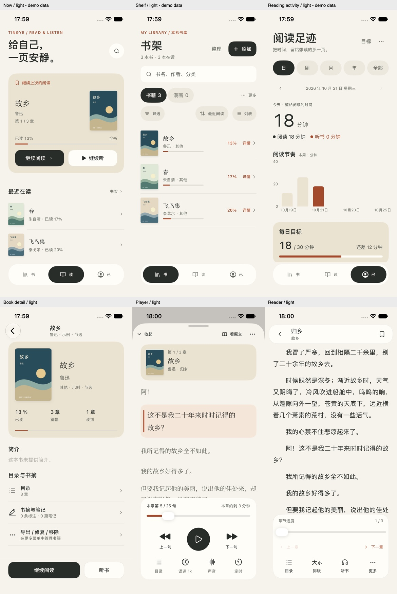
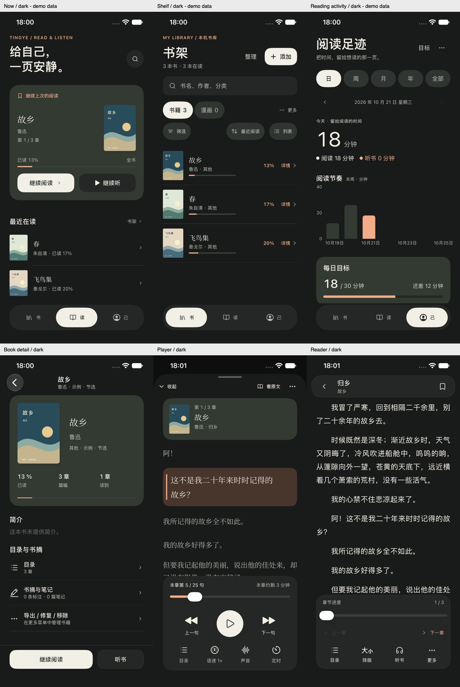

# 余白 · 原生运行截图

这些图片来自实际运行的 SwiftUI App，不是 Figma 渲染，也不是拼成的假界面。总览只是缩放、排版原始截图；未修改界面中的文字、数据或布局。

## 总览

| 日间 | 夜间 |
| --- | --- |
|  |  |

- [二级界面总览](secondary-overview.jpg)：导入、外观、备份、排版、目录与声音。
- [小屏与无障碍总览](accessibility-overview.jpg)：SE 3 首屏、键盘搜索、最大字号、横屏。

## 图像来源

### iPhone 17e：`light-*` / `dark-*`

390×844pt，iOS 27.0，原图 1170×2532px。由 `../capture-runtime.sh` 启动 DEBUG 临时书库并使用 `simctl io screenshot` 捕获。

数据来源为项目已有的 `-ui-fixture -ui-showcase`：公版《故乡》《春》《飞鸟集》节选、本地绘制的演示封面，以及明确用于视觉走查的模拟阅读记录。图中的「18 分钟」等**不是用户真实统计**。这些数据不会进入正常用户书库或 Release 功能。

| 画面 | 日间 | 夜间 |
| --- | --- | --- |
| 读 | [light-now.png](light-now.png) | [dark-now.png](dark-now.png) |
| 书架 | [light-shelf.png](light-shelf.png) | [dark-shelf.png](dark-shelf.png) |
| 阅读足迹 | [light-stats.png](light-stats.png) | [dark-stats.png](dark-stats.png) |
| 书籍详情 | [light-detail.png](light-detail.png) | [dark-detail.png](dark-detail.png) |
| 听书 | [light-player.png](light-player.png) | [dark-player.png](dark-player.png) |
| 正文 | [light-reader.png](light-reader.png) | [dark-reader.png](dark-reader.png) |

二级图对应 `light-sources.png`、`light-appearance.png`、`light-backup.png`、`light-reader-preferences.png`、`light-reader-contents.png`、`light-player-voice.png`。备份页为无可用 iCloud 的状态，不表示已执行云备份；声音页为系统声音，不表示验收了付费云服务。

### iPhone SE 3：`se-*`

375×667pt，iOS 27.0。来自本轮完整 **104 项 Passed** 的 XCTest 附件，使用长标题与长句回归数据，不使用演示统计。

- `se-now.png`：不滚动即可操作读 / 听、看到最近在读标题。
- `se-search.png`：键盘上方可点搜索结果详情。
- `se-shelf-accessibility.png`、`se-player-accessibility.png`、`se-reader-accessibility.png`：Accessibility XXXL；可滚动内容没有强行缩小字体，重要固定操作保持可达。
- `se-player-landscape.png`：来自追加的横屏复核测试，使用整个屏幕截图以避免 Xcode 27 应用截图裁切问题；未改像素内容。

## 设计稿

可编辑稿在 [Figma](https://www.figma.com/design/xJdLrqBJ9bUkstoEIG1CKY)。`../previews/figma-*.png` 才是 Figma 参考图，不能当成这些原生运行截图的替代证据。完整结果和限制见 [验收记录](../VALIDATION.md)。
